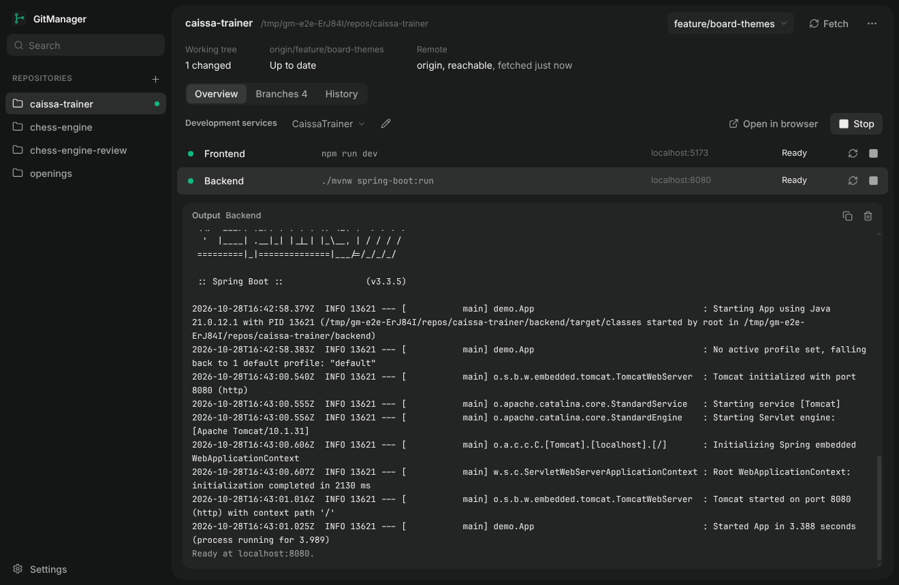

<p></p>

# GitManager

A desktop workspace for managing Git repositories, syncing branches, and launching development projects with one click. Built with Summa-UI.

Open GitManager, select a repository, fetch and pull, pick a branch, press Run, open the app in Chrome. GitManager is a local tool: no server, no account, no cloud. It uses the Git you already have, with your existing configuration, remotes and credentials.



## What it does

**Repositories**
- Automatic discovery at every launch: common development folders (`<home>\source\repos`, `<home>\Projects`, `C:\Projects`, `D:\dev` and similar, found from your home folder and drive letters, never from a user name) and the home folders of your WSL 2 distributions. Repositories appear in the list as they are found; worktrees are recognized, submodules and dependency folders are skipped, and the same folder reached through different paths (`\\wsl.localhost\...`, `/mnt/c/...`, junctions, letter case) is registered once. WSL scans stay on the Linux file system, so Windows drives are not scanned twice.
- Rescan from the add menu or Settings, and a deeper search of whole drives (or the whole home folder) on request. Discovery only registers repositories: it never pulls, switches, runs commands or writes to a repository.
- Register repositories yourself from a folder picker, a typed path, or a WSL path (`\\wsl.localhost\Ubuntu\home\me\app`, or `/home/me/app` with a distribution), or search folders you choose.
- A repository you remove stays removed: discovery remembers it (Settings lists them, with Restore).
- Searchable list with commits to pull or push and a marker when services are running.
- Remove a repository from GitManager; the folder on disk is never touched.

**Git**
- Current branch, working tree (clean, changed, untracked, conflicts), relation to the upstream (up to date, ahead, behind, diverged, no upstream, upstream gone, detached), remote configured and reachable.
- Fetch, compare incoming and outgoing commits, pull fast-forward only, list local and remote branches, switch branches, create a tracking branch from a remote branch, recent commits, open the folder, open in your editor.
- Concise errors with Git's own output one click away.

**Branches**
- Each repository opens on its **Overview** (status, fetch and pull, development services). The **Branches** tab is the deeper view: every local and remote-tracking branch compared with the repository's real default branch, searchable, filterable (All, Local, Remote) and sortable (name, ahead, behind, recent activity).
- The default branch comes from Git metadata, never from the name: the remote's recorded HEAD (`refs/remotes/<remote>/HEAD`), or what the remote advertises (`git ls-remote --symref`, read-only). `main`, `master`, `dev` or anything else works. When it cannot be determined (no remote, several remotes without origin), GitManager says so and you choose a comparison base, which is remembered per repository.
- Ahead and behind come from the commit graph (`rev-list --left-right --count <default>...<branch>`, or the equivalent `for-each-ref %(ahead-behind)` in one call on Git 2.41+). States: Up to date, Ahead, Behind, Diverged, Unrelated. Upstream sync is a separate column, and local and remote branches are separate rows with their own counts.
- Opening a branch shows its reference, comparison base, counts, latest commit, the commits only on it, the commits on the default branch it lacks, and the files changed since the merge base. Switching (or creating a local tracking branch) is an explicit button that reuses the safe switch, including the running-services guard. Inspection itself only reads.
- Remote data is labelled with the time of the last fetch, so it is not mistaken for live GitHub state.

GitManager never discards changes, resets, force-pulls, rebases, merges, deletes branches, force-pushes or stashes. Pull is `git fetch` followed by `git merge --ff-only --no-autostash`; a diverged branch, a missing upstream or conflicts are refused before anything runs, and when Git itself refuses (local changes would be overwritten) the repository is left exactly as it was.

**Development services**
- Each repository can have several profiles. A profile has a runtime (Windows, or a WSL distribution), a working directory, one or more services, a URL to open and a preferred browser (Chrome, Edge, system default).
- Each service has a command, a directory, environment variables, an optional env file and a readiness check (URL responds, or port open) with a timeout.
- Run starts all services concurrently; each has its own state (Starting, Ready, Running, Failed, Stopped) and its own output. A service is Ready only when its check passes; without a check it is Running, never Ready.
- Stop ends the process tree GitManager started (gracefully, then forced after a grace period). It never kills "whatever uses the port". If the readiness port is already taken before a start, GitManager refuses to start and leaves the other process alone.
- Switching branches while services run asks you to stop them first.
- Nothing from a repository is ever executed automatically. A profile runs only after you review its exact commands and trust it, and any change to a command, directory, environment or runtime asks again.

## Windows and WSL 2

- Native repositories use the Git on your PATH. WSL repositories use the Git inside their own distribution through `wsl.exe --exec`, never Windows Git on a `\\wsl$` path.
- WSL services start inside the distribution (`bash -lc`, so your login PATH, nvm, SDKMAN and similar apply) in their own process group, so Stop can end the whole Linux tree.
- Readiness checks run from Windows against `localhost`, so Ready also proves the browser on Windows can reach the service. If it cannot, the message points at WSL localhost forwarding.
- A Windows drive repository can run its services in WSL (`C:\code\app` becomes `/mnt/c/code/app`). A WSL repository always runs in its own distribution.
- Nothing assumes a user name, a folder layout, a distribution or installed tools.

## Install and run

Requirements: Git, Node.js 22 or newer. For WSL repositories, WSL 2 with Git installed inside the distribution.

```bash
npm install
npm run build
npm start
```

If Electron reports a missing binary after `npm install` (some environments skip install scripts), run `node node_modules/electron/install.js`.

Development with hot reload for the interface: `npm run dev` (restart it after changing `src/main`, `src/core` or `src/shared`).

### Windows package

```bash
npm run package:win
```

produces an NSIS installer and a portable zip in `release/` (x64, unsigned, no auto-update). Build it on Windows; the GitHub Actions workflow builds the same package on `windows-latest` and attaches it to every run as the `GitManager-windows-x64` artifact. Windows SmartScreen warns about unsigned installers; choose "More info", then "Run anyway".

Your configuration (repositories, profiles, settings) lives in `%APPDATA%\GitManager\gitmanager.json` on Windows (`~/.config/GitManager` on Linux, `~/Library/Application Support/GitManager` on macOS). It is never written into a repository.

## Tests

```bash
npm run verify:summa-ui   # the pinned Summa-UI release is intact
npm run verify:branding   # logo colours, transparency, ICO frames, packaging icons
npm run typecheck
npm test                  # unit and integration tests: temporary Git repositories and real processes
npm run test:e2e          # the first-release acceptance scenario against the built app
```

`npm run test:e2e` builds a CaissaTrainer-shaped project (a Vite frontend and a Spring Boot backend started with `./mvnw spring-boot:run`) in a real Git repository with a bare remote and a teammate clone, then drives GitManager through registration, fetch, fast-forward pull, branch switching, profile setup, Run, readiness, logs, Open in Chrome, Stop, restart of the app, and a refused unsafe pull. It needs Java and Maven, Chrome or Chromium, and a display (`xvfb-run` on Linux). It writes screenshots, Summa-UI check results and a step report to `e2e-output/`.

## Documentation

- [Architecture](docs/ARCHITECTURE.md): modules, process model, security, Windows and WSL execution.
- [Summa-UI adoption](docs/SUMMA_UI_ADOPTION.md): pinned release, component reuse, deviations, check results, feedback filed.
- [Acceptance results](docs/ACCEPTANCE.md): what was verified, how, and what was not.
- [Branding](docs/BRANDING.md): the Summa application logo system and how GitManager uses it.
- [Third-party notices](THIRD_PARTY_NOTICES.md).

## License

MIT, see [LICENSE](LICENSE).
