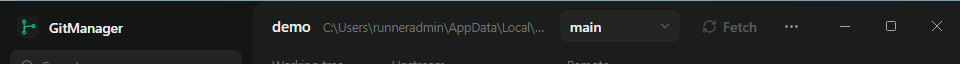

# First-release acceptance

`scripts/e2e.mjs` runs the first-release scenario end to end against the built application. The results below are from the run recorded in [`acceptance-report.json`](acceptance-report.json), on Linux (Electron 45 under Xvfb), with real Git repositories, a real Vite dev server, a real Spring Boot application started by `./mvnw spring-boot:run`, and Chromium as "Chrome".

## The fixture

A CaissaTrainer-shaped project (`scripts/e2e/template`): `frontend/` with `npm run dev` (Vite on port 5173, proxying `/api` to the backend) and `backend/` with a Spring Boot 3.3 application on port 8080 and a generated Maven wrapper. It is committed to a fresh repository, pushed to a bare `origin`, and cloned twice: the clone registered in GitManager and a teammate clone that pushes changes during the run.

For automatic discovery the run also builds a home folder (`GITMANAGER_HOME`): `Projects/chess-engine` with a submodule and a linked worktree `Projects/chess-engine-review`, `code/openings`, a repository inside `Projects/site/node_modules`, and one five levels deep.

## Results: 48 of 48 steps passed

| # | Scenario step | Verified by |
| --- | --- | --- |
| 1-4 | Open GitManager: automatic discovery | without any action, chess-engine, its worktree and openings appear in the sidebar; the dependency-folder repository, the submodule and the too-deep repository do not; the worktree is labelled; the discovered repositories' status and stash are unchanged |
| 5 | Register an existing repository | the add menu's Add repository with the clone's path (outside the scanned folders); listed in the sidebar |
| 6-8 | Branch and working tree status | `main`, Clean, Up to date, `origin, reachable` (a real `git ls-remote`) |
| 9 | Uncommitted work detected | `README.md` edited outside GitManager; Refresh shows "1 changed" |
| 10 | Fetch | the teammate pushed 2 commits; after Fetch, `HEAD` is unchanged |
| 11-12 | Ahead, behind or diverged | "2 commits to pull", Pull 2 appears, History lists the incoming commits |
| 13 | Fast-forward pull | `HEAD == origin/main`, the uncommitted edit is intact, `git stash list` is empty |
| 14-15 | Switch branch without losing work | `origin/feature/board-themes` chosen in the picker creates a tracking branch; the uncommitted edit came along |
| 16-18 | Branches tab | origin/feature/board-themes 1 ahead, 0 behind origin/main; origin/main detected as the default from the remote and marked Default; the checked-out branch marked with a check icon and text for assistive technology |
| 19 | Branch inspection is read-only | opening a branch shows its unique commit and changed file (THEMES.md); `HEAD`, the working tree and the stash are unchanged |
| 20 | Overview by default | after selecting another repository and coming back, the Overview tab is selected |
| 21 | Configure and select a profile | Frontend (`npm run dev`, `frontend`, ready when http://localhost:5173 responds) and Backend (`./mvnw spring-boot:run`, `backend`, ready when port 8080 is open) |
| 22-24 | Start both, observe progress | trust confirmation lists both commands; Backend shows Starting while Maven runs; each becomes Ready only when its own check passes |
| 25-26 | Logs | Spring Boot's "Started App" and Vite's banner in each service's output |
| 27 | Open in Chrome | GitManager launches the configured Chrome; the test reads the open tab over the DevTools endpoint: `http://localhost:5173/`, title "CaissaTrainer · backend UP" (the page reached Spring Boot through Vite) |
| 28 | Branch switch while running | the confirmation "Stop services to switch branches?" appears; Cancel leaves the branch unchanged |
| 29 | Stop both | both Stopped; ports 5173 and 8080 closed; the Spring Boot JVM (a grandchild of the shell GitManager started) is gone |
| 30 | Remove a discovered repository | the worktree is removed from GitManager; its folder stays on disk |
| 31-32 | Close and reopen | discovery runs again at launch and does not bring the removed worktree back; repository, profile, selected profile and branch restored |
| 33 | Unsafe operation refused | a local commit and a teammate commit make `main` diverge; Pull is refused with an explanation; `HEAD`, the working tree and the stash are unchanged, and the remote file did not appear |
| 34-36 | Title bar | with the window controls overlay on (`GITMANAGER_TITLEBAR=overlay`; on by default on Windows): the drag strip is 52 px tall and ends where the caption buttons begin; no button, input, tab or switch inside it is draggable; nothing sits under the caption buttons; the panel under them is `#1B1C1C`; the same holds in Settings and with a dialog open |
| 37-40 | Minimize to system tray | no tray icon while the setting is off; switched on and saved in Settings, General: the icon appears with Open GitManager and Quit GitManager; minimizing hides the window; clicking the icon restores it |
| 41-42 | Launched at sign-in, Start minimized | started with `--launched-at-login`: the window stays hidden behind the tray icon; no service is running and the repository's `HEAD`, branch and working tree are unchanged |
| 43-44 | Single instance | a second GitManager process exits with code 0 and the hidden window is shown; the tray icon goes away with it (Minimize to system tray off) |
| 45 | Title bar after a hidden start | once the window that started hidden is shown, the title bar layout is active (the defect the Windows scenario found) |
| 46-48 | Tray quit, manual launch | a hidden window always has the tray icon; Quit GitManager ends the process; a launch without the argument opens the window although Start minimized is on |

Screenshots of each stage are in [`screenshots/`](screenshots/); `16-title-bar.png` is the whole window as the X server draws it, caption buttons included (Linux draws its own round buttons; Windows draws its native ones, see below). The same scenario also ran Summa-UI's objective checks on six screens (see [SUMMA_UI_ADOPTION.md](SUMMA_UI_ADOPTION.md)).

The automated tests (`npm test`, 104 tests on Linux; one more runs only on Windows) additionally cover, against temporary repositories and real processes:

- Git: status parsing for every change kind and sync state, pull refusals (diverged, local changes would be overwritten, `pull.rebase` and `merge.autostash` configured), switch refusal, branch name injection, tracking branches.
- Branches: default branch from `refs/remotes/<remote>/HEAD` and from `ls-remote --symref` (with the local remote HEAD deleted, and not written back), a default named `dev`, no remote, several remotes without origin, a chosen base and a vanished one; branches 7 ahead, 5 behind, 2 ahead and 3 behind, unrelated history, local and remote copies with different tips, a gone upstream, detached HEAD, empty repository; the same counts without Git 2.41's `%(ahead-behind)`; cache reuse and recomputation; unique and missing commits and changed files; and every inspection leaves `HEAD`, the index, the working tree, the stash, the refs and the config byte-identical.
- Discovery: worktrees, submodules, separate git directories, fake `.git`, dependency and hidden folders, depth, symbolic links, unreadable folders, the folder budget, the WSL scan script run with real `sh` and `find`, common locations from the home folder, registration once with progress events, preserved manual repositories, profiles and settings, removed repositories never coming back across restarts until added manually, the same folder through `C:\`, `/mnt/c` and `\\wsl.localhost` paths, unreadable roots reported without stopping, and discovery leaving repositories untouched.
- Startup and tray: the `--launched-at-login` argument, Start minimized only for that launch, when the tray icon is wanted, defaults off; the startup entry against a fake that behaves like the Run key and Task Manager's StartupApproved key (the installed executable and argument are written, an entry turned off in Task Manager reads as off and is approved again when switched on, nothing is ever written from a development build or off Windows); saving and correcting the settings through the backend; the title bar colours checked against the Summa-UI tokens.
- Sidebar groups: Windows first, then WSL distributions by name, list order kept inside a group, no grouping for a single environment.
- Processes, persistence (including a configuration file from before discovery existed), trust, env files and path conversion, as before.

## The installed Windows build: 30 of 30 steps passed

`scripts/e2e-windows.mjs` runs in CI on `windows-latest` after the package is built. It installs the NSIS installer silently for the current user and tests the installed `GitManager.exe`, not a development Electron. Mouse and keyboard input go through Windows (`SetCursorPos`, `mouse_event`, `keybd_event` in `scripts/e2e/win-input.ps1`), so hit testing, the caption buttons and Snap are Windows' own; colours are read from the screen.

| Area | Verified on the installed build |
| --- | --- |
| Install | the installer puts `GitManager.exe` in `%LOCALAPPDATA%\Programs\GitManager`; the desktop and Start menu shortcuts start it; the installed executable carries all seven GitManager icon frames |
| Start | `app.isPackaged`, `process.execPath` is the installed executable; automatic discovery finds a repository in the test home folder on a real Windows file system |
| Title bar, normal and maximized | the drag strip ends where Windows' caption buttons begin (137 px at 100 %), no control in it is draggable, none sits under the buttons; screen colours: `#141515` beside the logo, `#1B1C1C` next to and behind the caption buttons (no native white or grey bar) |
| Window behaviour | double-click on the title bar maximizes and restores; the maximize button maximizes and restores; the minimize button minimizes; dragging the title bar moves the window; dragging the corner resizes it; Win+Left snaps it to the left edge at full height (never below the 920 px minimum width) |
| Display scaling | at a 150 % scale factor the title bar has the same layout in device-independent pixels |
| Startup entry | off by default and no entry; switched on in Settings, General: `HKCU\...\Run\GitManager` = `"<installed>\GitManager.exe" --launched-at-login`, never `electron.exe`; turned off through Task Manager's StartupApproved record (`03`): Settings shows it off with the reason; switched on again: approved (Electron removes the record) |
| Tray | icon with Open GitManager and Quit GitManager; the real minimize button hides the window in the tray; clicking the icon restores it; Quit GitManager ends the process |
| Start at sign-in | started with `--launched-at-login` and Start minimized: the window stays hidden behind the tray icon, no service runs, the repository's `HEAD` and working tree are unchanged, the repository list is intact; the tray icon opens the window |
| Single instance | a second `GitManager.exe` exits with code 0 and shows the running window, also from the tray |
| Close and uninstall | the close button quits; the silent uninstaller removes GitManager and its Run and StartupApproved entries |

The scenario found one real defect, fixed before release: the title bar layout was decided once at page load, while the window was still hidden, so on Windows it could stay in the native-frame layout. It now follows the overlay's `geometrychange` event, and both scenarios check a window that started hidden.

## Not verified here

- **Discovery on Windows and in WSL 2.** The Windows common locations (`<home>\\source\\repos`, drive-level folders such as `C:\\Projects`, the drive-letter probe), the WSL distribution list and home folder lookup, and the WSL scan running inside a distribution were not run on Windows or WSL. The WSL scan script itself was run with `sh` and `find` on Linux, and the Windows path handling and deduplication are unit-tested; the Windows-only location test runs in CI on `windows-latest`. On a real machine, note that scanning a WSL distribution starts it if it was stopped.
- **The default branch over the network on hosted remotes.** `ls-remote --symref` was tested against a local bare repository, not against GitHub with real credentials.

- **Windows 11 and WSL 2.** The development environment is a Linux container without Windows or WSL. The Windows branches (cmd.exe services, taskkill tree termination, Chrome discovery, Explorer) and the WSL branches (wsl.exe Git, `setsid` process groups, `--list --verbose` parsing, UNC paths, `/mnt` conversion) are covered by unit tests of the exact commands they construct, not by running them. The CI workflow runs the unit and integration suite on `windows-latest` (passing, run 2 of the CI workflow), which exercises the native Windows code for real: Git through Git for Windows, services through `cmd.exe`, tree termination through `taskkill`, including grandchild processes and the forced stop after the grace period. WSL is not available on hosted runners. Please run the scenario on a Windows 11 machine with a WSL repository before relying on the WSL path.
- **The Windows installer on a personal desktop.** CI installs and drives it on `windows-latest` (Windows Server, 1024 x 768, 100 % scaling; see above). Not covered there: a real high-DPI display (only a forced 150 % scale factor), Windows 11's rounded corners and Snap layouts flyout on hover over the maximize button, the tray icon's own mouse handling in the notification area (the scenario triggers the icon's click and menu items in the main process), and an actual sign-in that runs the startup entry (the scenario runs the entry's exact command instead).
- **Real Google Chrome.** The run recorded here used Chromium; the same scenario also passes in CI on `ubuntu-latest`, where the launcher wraps the runner's Google Chrome. Locally it used Chromium through a small launcher script (a separate profile, `--no-sandbox` because the container runs as root, a debugging port so the test can read the tab). GitManager only received the launcher's path as "Chrome location"; on Windows it finds Chrome in its standard install locations.
- **Credential prompts.** The fixture remote is a local bare repository. GitManager leaves authentication to Git (credential helpers work; terminal prompts are disabled because there is no terminal); a remote that needs an interactive terminal prompt will fail with an authentication message instead of hanging.
