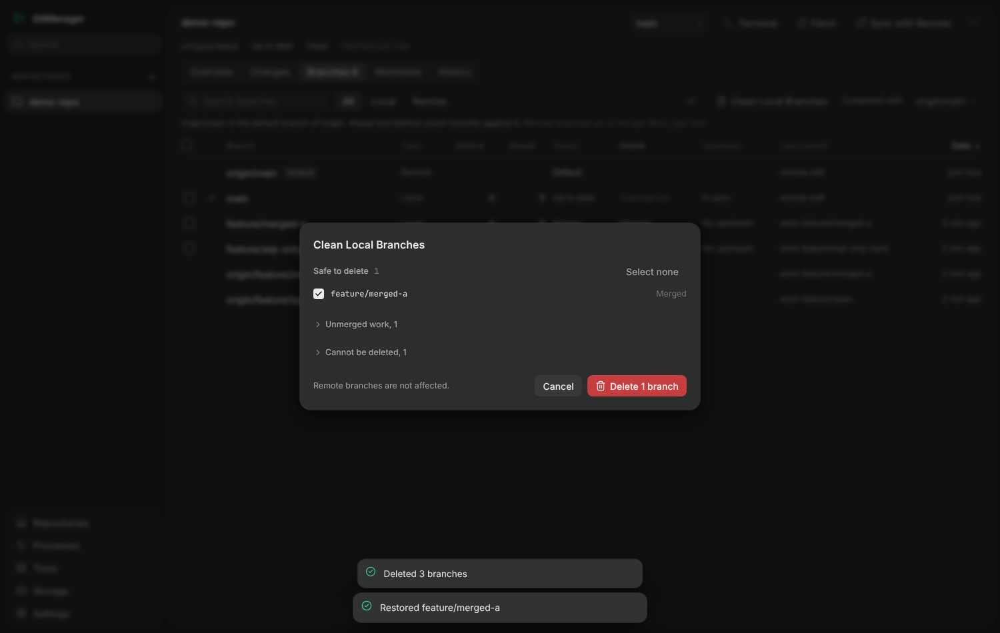
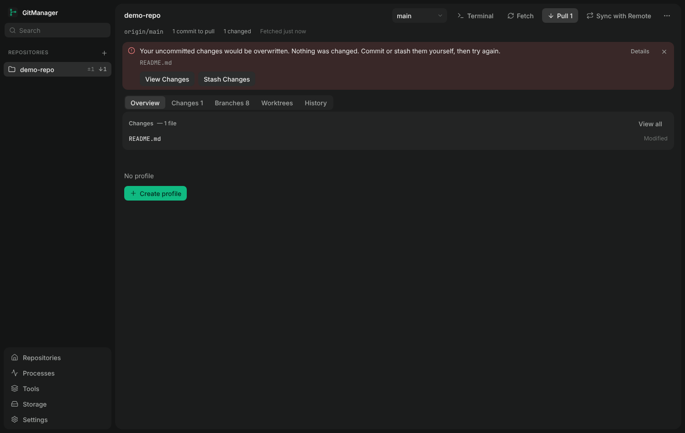

# Branch management and cleanup

The **Branches** tab is the one place for branches. It lists local and remote-tracking branches against the repository's default branch (see Branch overview in [ARCHITECTURE.md](ARCHITECTURE.md)) and adds selection,
deletion status and cleanup. Code: `src/core/git/branchClean.ts`, `recovery.ts`, `src/renderer/Branches.tsx`, `CleanBranches.tsx`, `branchSelection.ts`. Tests: `test/changes/branchClean.test.ts`, `test/renderer-changes.test.ts`.

## Selection

Local branches have a checkbox: click to toggle, Shift+click for a range (in the order shown), the header checkbox or **Select all visible** for the branches the search and filter show, **Select all eligible**
for every branch that can be deleted without force, **Clear selection**. The selection survives searching and filtering ("2 hidden by the filter"). Remote-tracking branches are not selectable: GitManager never deletes remote branches.

## What each branch is

Every local branch is classified against the default branch (the remote's, never guessed), the remote-tracking refs and the worktrees:

| Status | Meaning | Deleting |
| --- | --- | --- |
| Merged | the tip is in the default branch | `git branch -d` |
| Pushed / Upstream gone | not merged, but every commit exists on a remote branch | `git branch -d` |
| Unmerged work | commits that exist on **no** remote (no upstream, upstream gone, or never pushed) | `git branch -D`, only when asked for by name and acknowledged |
| Checked out | the current branch | blocked: *Switch to <default>* |
| In worktree | checked out in another worktree | blocked: *Open Worktree* |
| Protected | the default branch, or `main`, `master`, `develop`, `development`, `trunk`, `release/*` | blocked |

A dirty working tree is **not** a blocker for deleting some other branch. It only matters when switching (the switch reports the files: View Changes or Stash Changes).
`-d` compares with a branch's own upstream or HEAD, so a branch proved merged or fully pushed that `-d` refuses is deleted with `-D` after that proof, and recorded as not forced.
A branch with unique commits is never deleted without force; a branch without an upstream is **not** assumed disposable.

## Deleting

Select branches and **Delete…**, or open one branch and use its panel. The dialog re-analyses, groups the selection (safe, unmerged work, cannot be deleted with the reason and the next action) and for unmerged work states how many commits exist only on this
computer and whether a remote has part of them; the button stays disabled until that is acknowledged. The backend checks each branch again right before deleting it (still exists, same commit as shown, not checked out, not protected, still safe or explicitly forced),
continues after a failure, and returns **deleted / skipped / failed** with the reason for each.

## Recovery

Before each deletion the branch name, commit id and the exact command are written to `branch-recovery.json` beside the settings (names and ids only): `git branch <name> <sha>`. The result shows them with Copy and **Restore** (recreates the branch if the commit still exists
and the name is free). Git keeps unreachable commits for a while (about two weeks by default, until `gc`), not forever.

## Clean Local Branches

1. Optional **Fetch and prune remote branches first**: the existing Sync with Remote plan runs (`git fetch --prune`; only remote-tracking refs change). A failed fetch is reported and the preview continues with what was fetched before.
2. Every local branch is inspected as above. 3. The preview lists *Safe to delete* (preselected, with Select all / none), *Unmerged work* (collapsed, never preselected, its own Select all) and *Cannot be deleted* (with actions).
4. **Delete** removes exactly the selection, with the same per-branch recheck, partial results and recovery list. Remote branches are never touched.

## Blocker resolution elsewhere

An error carries the blocker Git actually reported and only the actions that resolve it: local changes (the files, **View Changes**, **Stash Changes**), running services (their names, **Stop services**), a branch in another worktree (the folder, **Open Worktree**),
conflicts (**View conflicts**), a lock file or a permission error (the file named; **Try again** only, nothing is deleted for you), a missing upstream (stated, no invented fix). Nothing destructive happens without its own confirmation.
