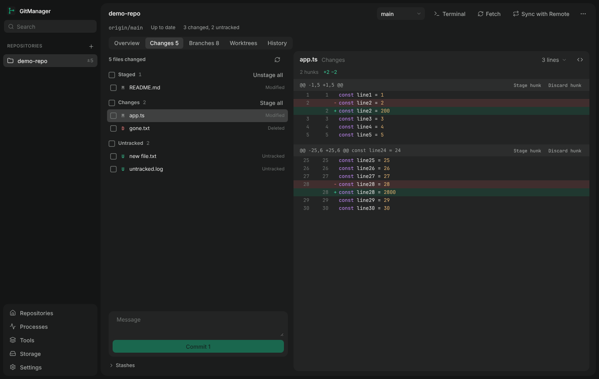

# Working-tree changes and stashes

The repository's **Changes** tab and the **Changes, N files** summary on its Overview replace opening another tool to see what changed.
Code: `src/core/git/changes.ts`, `src/core/git/stash.ts` (Git), `src/renderer/Changes.tsx`, `Stashes.tsx`, `DiffView.tsx` (page). Tests: `test/changes/` (real temporary repositories).

## What is shown

`git status --porcelain=v2 -z --untracked-files=all` becomes one entry per path: staged and unstaged state (modified, added, deleted, renamed, copied, type change),
untracked, and conflicted (with what each side did). A file with staged and unstaged changes appears in both **Staged** and **Changes**; **Untracked** and **Conflicts** are their own groups.
The number of changed files (distinct paths) is on the Changes tab, the Overview and the repository list. A merge, cherry-pick or revert in progress is stated.

A file opens as a unified diff: both line numbers, additions and deletions in colour, 3 / 10 / 30 / whole-file context, light syntax colouring where the file type is known (no colouring otherwise).
Staged and unstaged diffs are separate; an untracked file is shown as all additions; binary files say so.

## What each action does

| Action | Git | Notes |
| --- | --- | --- |
| Stage (selected / all) | `git add -A -- <paths>` | *all* leaves conflicted files, which need a decision |
| Unstage (selected / all) | `git restore --staged -- <paths>` | before the first commit: `git rm --cached` |
| Discard changes | `git restore --worktree -- <paths>` | unstaged changes of tracked files only; staged changes are kept; needs confirmation listing the files; a snapshot (`git stash create`) is recorded first and the recovery command shown |
| Restore a deleted file | `git restore` (`--source=HEAD --staged --worktree` for a staged deletion) | |
| Delete untracked | OS trash, or `git clean -f -- <paths>` | trash first; permanent only after a second confirmation, and Git itself refuses tracked and ignored files |
| Stage / unstage / discard one hunk | `git apply --cached [--reverse]` / `git apply --reverse` with the patch on stdin | the diff is read again and the hunk must still have the same content id, otherwise it is refused as stale |
| Commit | `git commit -F -` | staged changes only; refused with conflicts or nothing staged |
| Open in editor | the configured editor command with the file | |

None of these is `git reset`, `git checkout -- <path>`, `git revert` or a whole-repository `git clean`. **Restoring files is not reverting a commit**; GitManager has no revert action.
Every path is checked against a fresh status (a path that changed since the list was read is refused, not guessed at), must be repository-relative without `..`, and is passed after `--` with
`--literal-pathspecs`, so a file called `*.txt` or `-rf` is just a file name. Git runs with argument arrays, never a shell string.

## Stashes

*Stash changes* (optional message, *Include untracked files*), the list with branch and age, *Preview* (files and per-file diff, tracked and untracked), *Apply*, *Pop*, *Drop* (confirmed; the commit id and
`git stash apply <sha>` are shown). Every stash is addressed by position **and** commit, so a list changed from a terminal can never make an action hit another stash. Apply and Pop are refused
**before Git runs** when the stash writes a file that has local changes, naming the files (View Changes, or Stash Changes first). A conflicted apply is reported as conflicts; Git keeps the stash after a conflicted pop and so does GitManager.

## Staying current

The status is read when the tab opens, after each operation, when the window regains focus, on Refresh, and when the repository changes behind GitManager's back: a watcher on the Git directory
(index, HEAD, refs, stash) reports a change after a short quiet period, with no Git command running in between. Edits to files in the working tree are picked up on the next focus or Refresh (watching every
file of a large tree would be the expensive part). The watcher covers folders on this computer, not WSL file systems.

## Limits

Hunk actions apply to ordinary modified files (not new, deleted, renamed, binary or very long diffs: those are staged or discarded as a whole). Syntax colouring is per line, so a comment or string that spans lines is coloured only where it starts.
