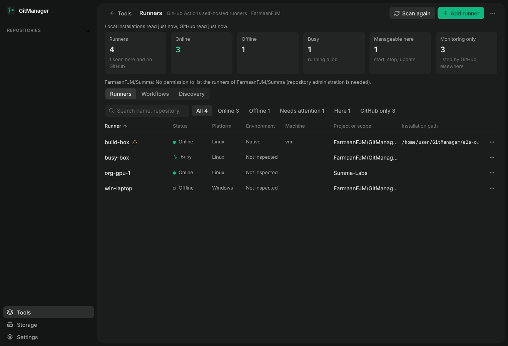

# Runners (Tools)

The **Tools** entry in the sidebar holds developer utilities that are not about one repository. The first tool is **Runners**: GitHub Actions self-hosted runners on this computer, in WSL 2 distributions, and on other machines, found automatically, read from GitHub, installed through a guided setup, and maintained from one table.

More screenshots from the acceptance run: [details](screenshots/runners-04-detail.png), [workflow matching](screenshots/runners-05-workflows.png), [the reviewed plan](screenshots/runners-09-plan.png), [the installation](screenshots/runners-10-installed.png), [the narrow layout](screenshots/runners-12-narrow-table.png), [uninstall confirmation](screenshots/runners-14-uninstall-confirm.png).

## What it answers

| Question | Where the answer comes from |
| --- | --- |
| Which runners do I have? | Installations found on reachable machines (`.runner` metadata, service registrations) and the runners GitHub lists for your repositories and organizations, reconciled by GitHub's runner id within the registration scope. |
| Online, offline, busy? | GitHub's runner API only. The local service state is a separate column of facts; the two are never merged into one word. |
| Which system and machine, native or WSL 2 or remote? | The host the installation was found on (this computer, a WSL distribution by name and version, an SSH host) and `uname` on that host. A runner only GitHub knows is shown as "Not inspected" with no path or machine. |
| Where is it installed, which service runs it? | The installation directory, the systemd unit, launchd agent or Windows service the runner itself recorded in `.service`, and its current state. |
| Which repository or organization, which labels, which group? | GitHub's record (default labels, custom labels, runner group for organizations). Local metadata gives the registration URL when GitHub cannot be read. |
| What can GitManager do with it? | Per runner: start, stop, restart, inspect, logs, check for updates, update, remove the registration, uninstall, each enabled only when it is possible and safe, with the reason shown otherwise. |
| What needs attention? | Installed version older than the latest release, a service running while GitHub reports offline (or the reverse), installation files without a registration, a registration GitHub no longer lists, missing credentials, a WSL service that only runs while the distribution runs. |

The summary row counts total, online, offline, busy, manageable here and monitoring only. "Monitoring only" are runners GitHub lists on machines this GitManager cannot reach.

## Discovery

Discovery runs at launch (Settings, or the Discovery tab; on by default, local files only) and on **Scan**. It is read-only, bounded (time budget per host, folder caps, hidden and dependency folders pruned) and cancellable.

**Local, per host:**

- Linux and macOS: `/opt`, `/srv`, `/var/lib`, `/usr/local`, `/home`, the home folder, `/Users` (macOS) and `*runner*` folders directly under `/`, plus the `WorkingDirectory` of `/etc/systemd/system/actions.runner.*.service` units and of `~/Library/LaunchAgents/actions.runner.*.plist` agents. One `sh` run per host does the whole inspection, so an SSH host costs one round trip.
- Windows: every Windows service named `actions.runner.*` (`sc.exe query`, then `sc.exe qc` for the binary path, which names the folder), the drive roots, the profile folder and `ProgramData` two levels deep, and running `Runner.Listener.exe` processes by executable path.
- WSL 2: the same Linux inspection inside each distribution through `wsl.exe -d <distro> --exec`; paths stay Linux paths, the distribution name and version are kept.
- Folders you add under Discovery are inspected too (four levels deep).

A folder counts as an installation when it holds the runner's own `.runner` file, or the runner program (`bin/Runner.Listener`) next to `config.sh` or `config.cmd`. A folder merely named `actions-runner` is not one. `.credentials` is only checked for existence and never read. The version comes from `Runner.Listener --version`, or from the newest diagnostic log when the program cannot run. Running runner processes are identified by their working directory (`/proc`) or executable path, never by name alone.

The same installation reached through two paths (`\\wsl.localhost\<distro>\...` and the Linux path, `/mnt/c/...` and `C:\...`, letter case) is listed once.

**GitHub:** through the GitHub CLI session (`gh auth login`), for the repositories registered in GitManager that have a github.com remote, the scopes local installations point at, repositories and organizations you add under Discovery, your organizations, and up to 30 further repositories you administer. Each scope is reported separately: read, no permission (GitHub answers 403, or 404 without administration permission), not found, rate limit, not read. Records from a scope that could not be re-read are kept from the previous scan rather than silently dropped. What was left out is listed under Limitations and Discovery.

## Installing a runner

**Add runner** walks through platform, environment, GitHub scope, configuration, a reviewed plan and the installation.

1. **Platform.** Windows, Linux or macOS, only those some reachable host can run.
2. **Environment.** This computer, a WSL 2 distribution (name and version), or an allowed SSH host. The machine is probed first: system, architecture, user, whether systemd is PID 1, whether `sudo` works without a password. A remote Windows machine cannot be installed over SSH; the wizard says so and points at GitHub's instructions, and the runner is then monitored through GitHub.
3. **Scope.** A repository (administrator permission) or an organization (administrator and the `admin:org` scope). Registered repositories come first; any repository you can reach can be looked up by `owner/name`.
4. **Configuration.** Name, directory (one per runner, must be new or empty), custom labels, runner group (organizations), service, service user (Linux), service account (Windows: NETWORK SERVICE, LOCAL SERVICE, LocalSystem or another account; GitManager never collects a password), start after registration, and under Advanced: replace, ephemeral, no self-update.
5. **Review.** The plan lists the target, the package and the source of its SHA-256, every command that will run (the token shown as a placeholder), whether administrator rights are needed and how, warnings, and blockers. A blocked plan cannot be installed. Planning never requests a token.
6. **Install.** Steps: checking environment, checking GitHub access (registration token), downloading, verifying, extracting, configuring, registering, installing service, starting service, verifying registration (GitHub lists the runner, and reports it online when it was started), verifying service (the local state). Output is shown with tokens redacted. Cancel stops between steps.

What the steps run:

| Step | Linux | macOS | Windows |
| --- | --- | --- | --- |
| Package | `actions-runner-linux-<arch>-<v>.tar.gz` | `actions-runner-osx-<arch>-<v>.tar.gz` | `actions-runner-win-<arch>-<v>.zip` |
| Checksum | GitHub's runner downloads API (`sha256_checksum`), else the release notes of actions/runner. No checksum, no installation. Download hosts are restricted to GitHub's release hosts. | | |
| Extract | `tar -xzf` | `tar -xzf` | `tar.exe -xf` |
| Configure | `./config.sh --unattended --url … --token … --name … --work _work [--labels] [--runnergroup] [--replace] [--ephemeral] [--disableupdate]` | same | `bin\Runner.Listener.exe configure …` (what `config.cmd` runs) `[--runasservice] [--windowslogonaccount]`, as administrator |
| Service | `./svc.sh install <user>` as root, `./svc.sh start` as root | `./svc.sh install`, `./svc.sh start` as your user | installed by configure; `sc.exe start <service>` as administrator |

Elevation: Linux uses `sudo -n` (the plan refuses when sudo would need a password and shows the command to run instead); WSL runs the privileged steps as root inside the distribution (`wsl -u root`); Windows asks through User Account Control; macOS needs none. GitManager never enables SSH, opens ports or changes firewall rules.

A failure stops at its step and reports what was done: files downloaded, files extracted, registered on GitHub, service installed, running. Nothing is deleted or overwritten on failure; the directory is yours to fix or remove.

## Managing a runner

For installations on reachable hosts: Start, Stop and Restart through the mechanism the runner recorded (`systemctl` as root, `./svc.sh` for launchd, `sc.exe` as administrator); a runner started by hand is stopped through its identified process only. Inspect re-reads the state; diagnostic logs show the newest `_diag` files, redacted. Check for updates compares the installed version with the latest release and says whether the runner updates itself or has `--disableupdate`. Update stops the runner, downloads and verifies the latest package, sets `bin` and `externals` aside, extracts, checks the reported version, removes the old files or restores them on failure, and starts the runner again if it was running; `.runner`, `.credentials` and `_work` are untouched.

Remove registration asks GitHub for a removal token and runs the runner's own `remove` (after removing its service), then confirms with GitHub; if the runner cannot remove itself, the registration is removed through the API and said so. Files stay. Uninstall deletes exactly the installation directory, shown in the confirmation, after the service is removed; it refuses while the runner is still registered unless you choose to remove the registration as part of it, and it refuses directories that are not installations or are system paths. A runner only GitHub knows can be removed from GitHub, with the note that its machine is not touched.

A runner GitHub reports busy is not stopped, restarted, updated or removed without an explicit confirmation that the job will be interrupted. Operations on one installation never overlap.

## Workflows

The Workflows tab reads the workflow files of a repository (the local clone when it is registered in GitManager, otherwise GitHub) and lists each job's `runs-on` labels, the runners whose GitHub-confirmed labels satisfy them (within the repository or its organization), GitHub-hosted jobs, jobs whose labels no runner offers, and runners no workflow asks for. Each runner's details show a copyable `runs-on` example (group form for organization runners). Files are read only. Matching labels do not grant access: organization runners serve the repositories their runner group allows, and the report says so.

## WSL

A runner inside a distribution is a Linux runner: Linux package, Linux paths, systemd service when the distribution runs systemd (`[boot] systemd=true` in `/etc/wsl.conf`). The service starts with the distribution, and Windows does not start distributions at boot; the inventory and the plan say so. Without systemd, the runner can be installed without a service and started with `./run.sh`. Windows drives seen from WSL (`/mnt/c`) are refused as installation directories.

## Settings and persistence

Settings, General has the two startup switches (find runners at startup, also read GitHub at startup). The Discovery tab has folders to inspect, repositories and organizations to read, SSH hosts to allow, and the refresh interval for GitHub status while the tool is open (on top of a refresh when the window regains focus; refreshes are rate-limited to one a minute).

`gitmanager.json` gains a `runners` section (settings and the non-sensitive memory of known installations: host, path, name, scope, id), validated on load like the rest; a file from before the tool existed loads with defaults. `runners-state.json` holds the last inventory (local observations, GitHub records, host and scope results, the latest release, recent installation jobs with redacted output). No token, credential or `.credentials` content is ever written.

## Permissions

| Operation | Needs |
| --- | --- |
| List repository runners | administration permission on the repository (`repo` scope for a classic token) |
| List organization runners, groups | organization administrator and `admin:org` |
| Register or remove a runner | the same, through registration and removal tokens (`POST …/actions/runners/registration-token`, `remove-token`), which GitManager uses once and never stores |
| Remove a registration directly | `DELETE …/actions/runners/{id}`, the only DELETE the Runners tool can send |

The GitHub CLI door for the Runners tool allows GET anywhere, POST only for those two token endpoints and DELETE only for one runner by id (`src/core/storage/gh.ts`, profile `runners`); the Storage module keeps its own door with its own, narrower rules. With `GITMANAGER_GH_RUNNERS_REQUEST_LOG` set, every request's method and path (never headers or bodies) is appended to that file.

## Security

A self-hosted runner executes the code of the workflows it is assigned. GitHub advises against self-hosted runners for public repositories that accept outside contributions; the wizard says so and asks for an acknowledgement. GitManager never changes repository or organization security settings. Tokens are time-limited, kept in memory for one step, redacted from output, previews, diagnostics and errors, and never persisted. Paths, names, labels, groups and accounts are validated before any command is built; commands are argument arrays (the SSH transport single-quotes every token; Windows elevation embeds every value as a quoted PowerShell literal). Downloads come only from GitHub's release hosts and are refused without a published SHA-256. Services and processes are acted on only when positively identified as the selected installation's. The renderer keeps Electron's sandbox and reaches the tool only through validated IPC methods.

## Troubleshooting

- **"GitHub has not been read yet"**: scan with the GitHub CLI signed in (`gh auth login`); startup scans read local files only unless you turn on "Also read GitHub at startup".
- **A scope says "No permission"**: listing runners needs administration permission. For organizations, `gh auth refresh -s admin:org`.
- **A runner shows Unknown status**: GitHub was not read, or its scope could not be read; the local service state is shown separately.
- **Service state unknown in WSL**: the distribution has no systemd. Enable it in `/etc/wsl.conf`, run `wsl --shutdown`, scan again.
- **Install blocked by sudo**: allow passwordless sudo for your user, or install without a service and run `./run.sh`.
- **Configure fails with missing libraries (Linux)**: run `bin/installdependencies.sh` as root in the directory, then run the configure command from the plan.
- **Update says the runner updates itself**: it does, within about a day of a release, unless `--disableupdate` was used. The manual update is for the cases where it did not.

## Verification

- Unit tests (`npm test`, 149 tests in `test/runners/`, 367 in all): metadata parsing; native Linux discovery with real `sh`, `find` and temporary installations (registered, service-less, partial, missing credentials, read-only guarantee); macOS and WSL records; Windows discovery with simulated `sc.exe`, PowerShell and folder output; duplicate detection; reconciliation; capabilities; attention rules; the GitHub API (pagination, group names, permission, not found, rate limit, tokens, delete); packages and checksums; the gh boundary for both profiles; validation and command construction; planning blockers; the complete installation and its failures (expired token, checksum mismatch, configure failure, service failure, cancellation, WSL copy and re-verification); service control for systemd, launchd and Windows; busy and confirmation guards; update with restore; unregister, GitHub fallback and uninstall safety; the manager (scan, hosts, unreachable host, rate limit, cancel, refresh limit, settings, choices, install, concurrency, links, workflows); backend argument validation; persistence and migration; the table logic and the navigation.
- Acceptance scenario (`npm run test:e2e:runners`, Linux under Xvfb): 62 of 62 steps, the real application against a stand-in GitHub CLI and a stand-in runner package whose configure step registers with that world. See [ACCEPTANCE.md](ACCEPTANCE.md) for the steps and results.
- Not verified on real systems in this work: native Windows (services, `tar.exe`, UAC), macOS (launchd), a systemd host for service installation, WSL distributions, SSH hosts, and GitHub administration access. Those paths are implemented from GitHub's documentation and exercised with fakes; treat them as unverified until run on such a machine, and report what you find.
