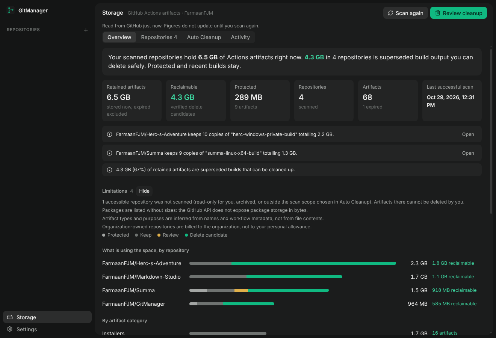
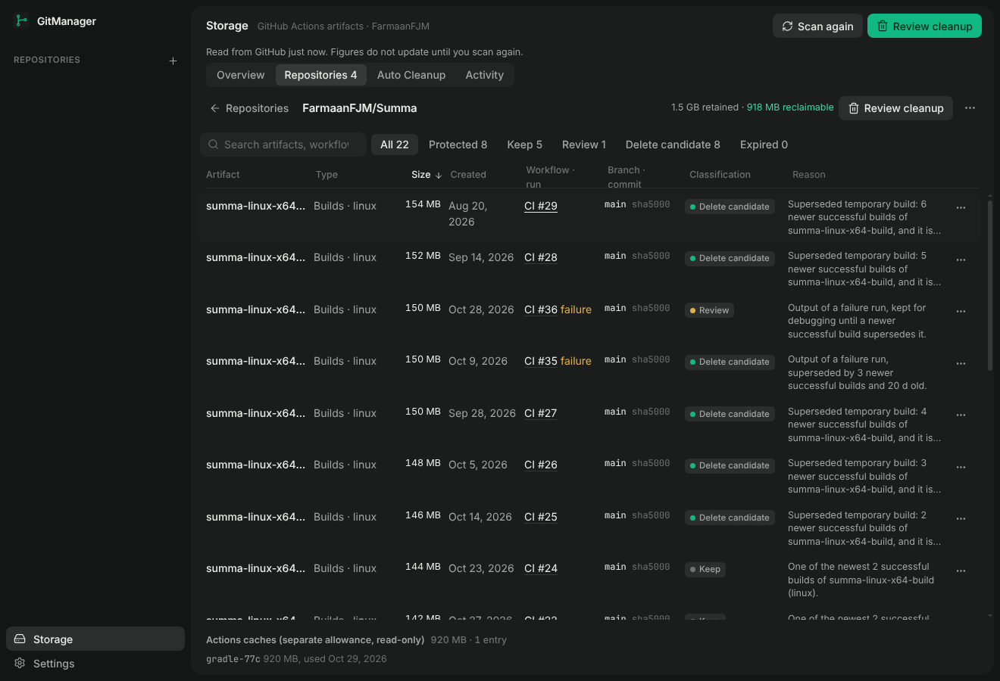
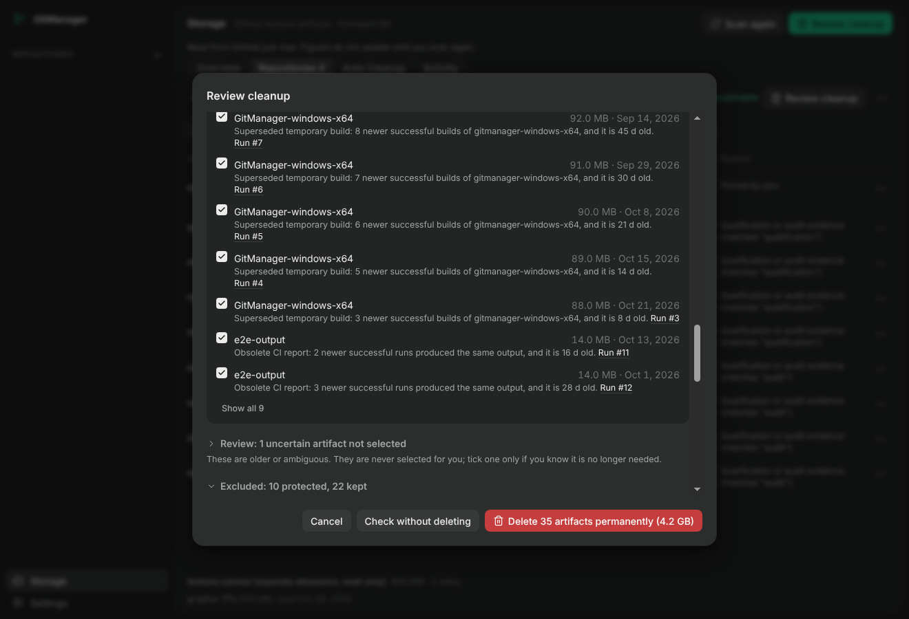
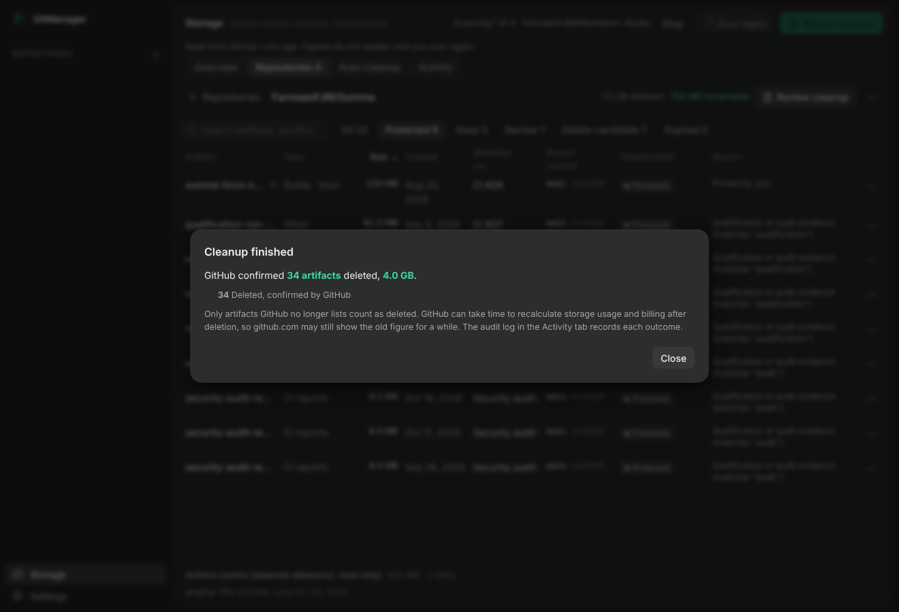
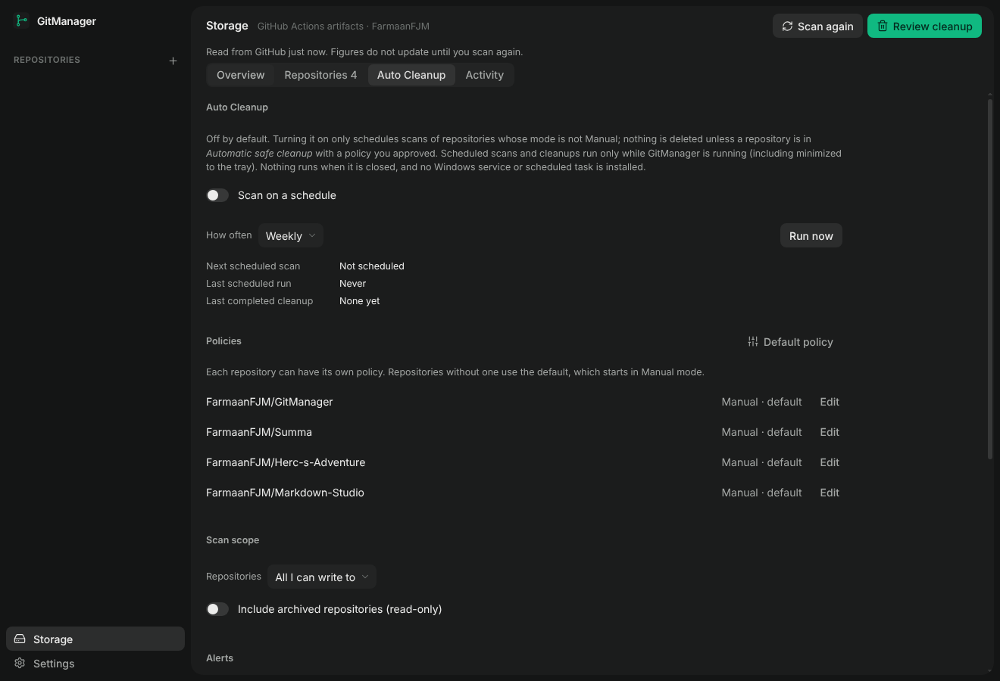

# Storage: GitHub Actions artifact maintenance

GitManager's **Storage** view finds what is using your GitHub Actions artifact storage, separates what is safe to delete from what must stay, shows what a cleanup would recover, deletes only what you approve, and can optionally do the routine part on a schedule. Open GitManager, Storage, Scan, Review cleanup, Delete.

It is a maintenance tool for build output, not a dashboard of invented numbers: every figure comes from the GitHub API through your own GitHub CLI session, and every limit of that API is stated in the interface.

## Requirements and sign-in

- The [GitHub CLI](https://cli.github.com) (`gh`) signed in: `gh auth login`. GitManager runs `gh api` and uses that session. **It never asks for a token, never reads one (`gh auth token` is not used), never logs or stores one, and sends nothing to any server of its own.**
- Scanning needs read access (any `gh auth login` session). Deleting needs write access to the repository's Actions: with a classic token that is the `repo` scope, which `gh auth login` grants by default.
- Without the write scope GitManager stays read-only and says so, with the command to fix it: `gh auth refresh -s repo`. It requests no other privilege by itself. Two optional extras need more scope, and the interface says which when they are missing: package listing (`gh auth refresh -s read:packages`) and billing (a classic token needs the `user` scope).
- Missing sign-in, a missing CLI and insufficient permission are reported separately.

## Discovery

**Scan** inventories every repository you can write to (Settings in Auto Cleanup: all you can write to, or only the ones you own; archived ones optional) using paginated calls, four repositories at a time. A repository that cannot be read is listed as such and does not affect the others. For each repository GitManager reads:

| Data | Endpoint |
| --- | --- |
| Repositories and your permission | `GET /user/repos` |
| Artifacts (name, size, created, expires, run, branch, commit) | `GET /repos/{o}/{r}/actions/artifacts` |
| Workflow runs (workflow, conclusion, event, pull requests) | `GET /repos/{o}/{r}/actions/runs`, then `.../runs/{id}` for runs not in the list (at most 60 per scan; completed runs are cached for the session) |
| Open pull requests | `GET /repos/{o}/{r}/pulls?state=open` |
| Releases and the commit of their tags | `GET /repos/{o}/{r}/releases`, `GET /repos/{o}/{r}/commits/{tag}` |
| Documentation (root and `docs/` Markdown, at most 15 files of 256 KB) | `GET /repos/{o}/{r}/git/trees/HEAD`, `.../contents/{path}` |
| Actions cache usage and entries | `GET /repos/{o}/{r}/actions/cache/usage`, `.../actions/caches` |
| Packages | `GET /user/packages?package_type=...` |
| Billing for the current month | `GET /users/{login}/settings/billing/usage` |

### What the numbers mean

- **Retained artifacts** is the sum of the sizes of artifacts that have not expired, as of the last scan. Expired artifacts are listed but hold no bytes and are excluded.
- **Actions caches** are shown separately. They have their own limit per repository, are evicted automatically by GitHub, and are not part of the artifact total. GitManager lists them read-only; it does not delete caches.
- **Packages** are listed (name, type, visibility, version count). **The GitHub API does not expose package sizes**, so none are shown.
- **Billing** shows what GitHub reports for the month: storage accrued in **GB-hours** and runner **minutes**. GB-hours are accumulated over time, not bytes stored now, and are never converted into or added to the retained-bytes figure. **GitHub's API does not report your included allowance**, so GitManager shows no allowance, remaining quota or percentage and does not estimate one. If billing cannot be read it says **Billing data unavailable** and links to GitHub's billing page. Organization-owned repositories are billed to the organization.
- After a deletion GitHub can take time to recalculate storage usage and billing; github.com may lag behind the real state.

## Classification

Every non-expired artifact is classified, and the reason is shown. Age alone never decides anything.

| Class | Meaning | Examples |
| --- | --- | --- |
| **Protected** | Never offered, not selectable. | Protected repository, pinned artifact, evidence (name or workflow matches `qualification`, `audit`, `evidence`, `attestation`, `provenance`, `sbom`, or your own words), cited by documentation, built for the current release (latest published release, drafts, latest pre-release) |
| **Keep** | Retained by the rules, not selectable. | Belongs to an open pull request, its run is still going, one of the newest N successful builds of its family (default 2), the last usable installer of a platform, recent (younger than the policy age) |
| **Review** | Uncertain, never selected for you. | Run or date unknown, purpose not recognised from the name, category not enabled by the policy, output of a failed or cancelled run not yet superseded, or any case where a lookup failed |
| **Delete candidate** | Superseded temporary output. | At least N newer successful builds of the same family exist, it is older than the policy age (7 days for builds, 14 for CI reports and logs), nothing above applies, and every lookup it depends on succeeded |
| **Expired** | Already purged by GitHub. | Nothing to reclaim |

How the rules work:

- **Family.** Artifacts with the same name after removing version numbers, commit ids and run numbers, in the same category (installer, build, CI report, log) and platform (Windows, Linux, macOS, Android, iOS), are compared with each other. Windows and Linux builds of one app are separate families.
- **Newest N successful.** Only runs that concluded `success` count. A protected artifact still occupies one of the newest-N slots (it is retained either way). N is at least 1: the last usable build is never offered.
- **Last usable installer.** For each platform, the newest successful installer is kept whatever the policy says (and if none succeeded, the newest installer).
- **Documentation.** A run URL (`.../actions/runs/{id}`) in the documentation protects that run's artifacts. An artifact name protects it only if the name is unique in the repository, because a recurring name such as `app-windows-x64` says nothing about one particular build.
- **Context.** If pull requests, releases, documentation or runs could not be read, candidates move to Review ("Could not check ..."). GitManager does not guess.
- **Heuristics.** Categories and purposes are inferred from names and workflow metadata, never from file contents. This is why the default is conservative and why you can pin artifacts and protect repositories.

## Repository details

Select a repository for a sortable, searchable table: artifact, type, size, created, workflow and run (opens the run on GitHub), branch and commit, classification and reason. Filters: All, Protected, Keep, Review, Delete candidate, Expired. The row menu pins an artifact (never deleted); the repository menu protects the whole repository, opens its cleanup policy or its Actions page. Pins and protections are stored locally in GitManager's configuration file.

## Cleanup preview and deletion

**Review cleanup** shows exactly what would be deleted, grouped by repository: each artifact with size, date, reason and run, the repositories affected, and the total that would be recovered. All verified candidates are selected; you can untick any, a whole repository, or all of them. Review (uncertain) artifacts are listed apart, never selected, and can be ticked individually. Protected and kept artifacts are listed as excluded with their reasons. Large lists stay readable: eight artifacts per repository are shown with "Show all".

There is one explicit authorization: the red button, whose label states the count, the size and that it is permanent. **Check without deleting** runs the same revalidation and sends no deletion request.

Before anything is deleted, per repository and per artifact, GitManager:

1. reads the repository again (permission, archived state) and re-classifies it with the current pins, protections and policy;
2. requires the artifact to still exist with the same id, name, size and workflow run, and to have the classification it had in the scan, else **skips it** (changed, now protected, now kept);
3. reads the artifact once more immediately before the request;
4. writes the attempt to the audit log, then sends `DELETE /repos/{o}/{r}/actions/artifacts/{id}` for that one artifact.

GitHub Releases and release assets are never touched (they are different endpoints GitManager does not call). There is no wildcard or bulk endpoint: ids are validated integers, one request each, paced about a second apart. GitManager never tries to get around a permission error: on `403` it stops that repository and carries on with the others; on `401` it stops everything; on a rate limit it waits if GitHub says it will lift within a minute and otherwise stops and reports the remainder as not attempted. Cancel stops after the current artifact.

**Results are GitHub's, not a prediction.** After the deletions the repository is listed again; an artifact counts as deleted only if GitHub no longer lists it. Per artifact the result is one of: deleted (confirmed), accepted but still listed (unconfirmed, not counted), already gone, skipped (changed or protected), denied, rate limited, failed, not attempted. Then the affected repositories are re-scanned so the screen shows GitHub's numbers.

### Audit log

`storage-audit.jsonl` next to `gitmanager.json` records artifact id, name, repository, workflow run, size, time, trigger (manual or scheduled) and outcome. An attempt is written before the request and its result after, so an interrupted run leaves a visible attempt that the next scan settles (gone means deleted, still listed means it did not happen). Each line contains the hash of the previous one; editing, removing or reordering a line is reported in the Activity tab. It contains no credentials and never leaves the computer.

## Auto Cleanup

Off by default. Nothing is scheduled, scanned or deleted until you turn it on.

- **Modes, per repository.** *Manual*: scan and clean only when you ask (scheduled scans skip these repositories). *Automatic recommendations*: scheduled scans prepare suggestions and nothing is deleted; they appear as a banner to review. *Automatic safe cleanup*: scheduled runs delete only high-confidence candidates (superseded builds and obsolete reports whose context was fully read) under a policy you approved.
- **Policy** (per repository, plus a default that starts Manual): number of newest successful builds to keep, age before superseded builds (default 7 days) and obsolete reports and logs (14 days) become candidates, categories that may become candidates, evidence words that are always preserved, and the size above which an automatic run waits for your approval instead of deleting ("require manual review for large deletions", default 1 GB).
- **Approval.** Automatic safe cleanup needs an explicit approval of exactly the values shown. Changing any value withdraws it and the repository runs as *recommendations* until you approve again.
- **Presets** (Summa: strict evidence preservation; Herc's Adventure: newest two builds; Markdown Studio: newest two installers per platform; GitManager: newest two Windows builds) only fill the form for you to review. They are proposals, not safety guarantees, are not applied to any repository by name, and do not know which of your artifacts are "private" or "verified".
- **Schedule.** Daily, weekly or monthly. The view shows the next scheduled scan, the last scheduled run and the last completed cleanup. **The schedule runs only while GitManager is running**, including minimized to the tray. If GitManager was closed when a run was due it runs shortly after the next launch. No Windows service or scheduled task is installed, and GitManager's startup and tray settings are unchanged (starting with Windows is its own opt-in in Settings). Closing GitManager means nothing runs.
- **Run now** performs one pass with the same rules, which is how to see what automation would do.
- **Alerts** in Storage (all can be switched off): sharp growth since the previous scan, a repository keeping many large copies of one build, old builds being a large share of storage, a quota error reported by GitHub while GitManager is talking to it, and a scheduled cleanup or scan that failed. An optional warning level in GB is your own number: GitManager cannot read your allowance and will not guess one. Optional system notifications are one quiet line per scheduled run.

## Limitations

- GitHub does not report included storage allowance, package sizes, or cache costs, so GitManager shows none of them. Billing needs extra permission and may be unavailable.
- GitManager does not see workflow uploads as they happen. A *storage quota exceeded* failure inside a workflow is not observed; the quota alert fires only when GitHub reports it in a response GitManager receives.
- Only artifacts that GitHub still lists can be found. Per scan: 10,000 artifacts per repository, 500 recent workflow runs plus up to 60 looked up individually, 15 documentation files.
- Classification is conservative inference from names and workflow metadata. "Private" or "verified" builds, qualification status and "ongoing audit investigations" are recognised only through your evidence words, pins, protected repositories and documentation references.
- Repositories in WSL or on Windows are irrelevant here: GitHub is addressed by repository name through `gh`, independent of local clones. Cleanup is separate from Git branch management; GitManager still never deletes branches.
- Caches and packages are inventoried read-only; they cannot be deleted from GitManager.
- Artifact deletion cannot be undone by GitManager or by GitHub.

## Where things are stored

| What | Where |
| --- | --- |
| Settings, policies, protected repositories, pins | `gitmanager.json` (`storage` key), local |
| Last scan | `storage-state.json`, local |
| Audit log | `storage-audit.jsonl`, local |
| Credentials | Not stored by GitManager; `gh` holds the session |
