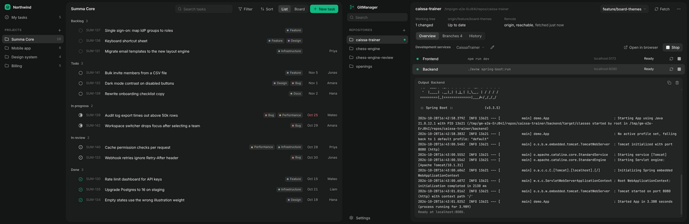
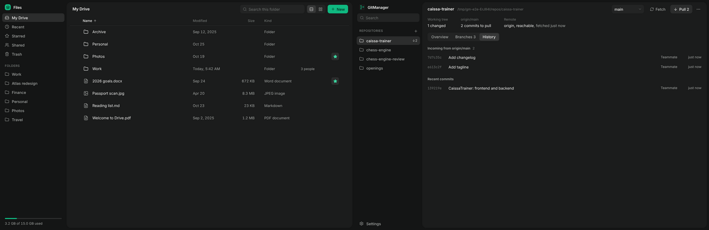

# Summa-UI adoption

GitManager is the first application built from Summa-UI that was not part of the Summa-UI laboratory. This document records what it consumes, how each part of the interface maps to Summa-UI, where it deviates and why, what the Summa-UI checks reported, and which guidance problems were filed back.

## Pinned release

| | |
| --- | --- |
| Release | `guidance-v0.1.0` (approved by FarmaanFJM, 2026-10-28) |
| Commit | `bd6d7e1f2c0d375913a61582c966ea311c102575` |
| Bundle digest | `5ef73215334c313089cb3cd87f6f78f65eef48f67dfdc5d53bd84fedad408cc7` |
| Lock | [`summa-ui.lock.json`](../summa-ui.lock.json) |
| Usage record | [`summa-ui.usage.json`](../summa-ui.usage.json) (written by Summa-UI's `record-guidance-usage.mjs`) |

How it was pinned (the contract in summa-ui `docs/SUMMA_INTEGRATION.md`):

1. `node scripts/verify-release.mjs guidance-v0.1.0 --expect-digest 5ef7…8cc7` in summa-ui: the annotated tag, every bundle file, the release record and the owner check out from git objects.
2. A worktree at the tag; `vendor-guidance.mjs third_party/summa-ui/guidance --lock summa-ui.lock.json --expect-digest …` copied the approved bundle and wrote the lock.
3. The optional React reference implementation and the shared component CSS were copied byte for byte from the same commit (`src/ui/*.tsx`, `src/presets/*`, `src/styles/base.css`) into `third_party/summa-ui/src/`, keeping their relative paths so they compile unchanged. Their sha256 values are in the lock's `reference` section.
4. `npm run verify:summa-ui` runs Summa-UI's own `verify-vendored.mjs` (copied unchanged) plus `verify-reference.mjs` in CI. Any modified, missing or extra file fails the build. GitManager-specific styling lives only in `src/renderer/app.css`.

GitManager does not consume `main` and will not change version silently. Moving to a newer approved release is a separate, reviewed change that re-runs the steps above and records a new usage file.

## What the interface reuses

| GitManager element | Summa-UI source | Notes |
| --- | --- | --- |
| Tokens, theme, surfaces | `guidance/css/tokens.css` | Charcoal s0 to s4, emerald accent, neutral focus and selection. No colour defined outside the tokens. |
| Base controls | `src/styles/base.css` | `.btn` variants, `.icon-btn`, `.input`, `.select`, `.tabs`, `.nav-item`, `.list-row`, `.popover`, `.menu-item`, `.dialog`, `.skeleton`, `.eyebrow`, focus ring. |
| Window layout | `AppShell`, `.brand` row, `NavItem`, `DrawerToggle` | Dark page, lighter main panel, 252 px sidebar, Settings in a lower sidebar region (P14). The brand row shows GitManager's logo (D4). |
| Repository search | `SearchInput` | |
| Add menu, More actions | `MenuButton`, `Menu` | Destructive "Remove from GitManager" is last, after a separator, danger text and icon (P19 exception for menus). |
| Profile, runtime, browser, readiness, depth selects | `Dropdown` | Profile select is creatable: "Create profile" sits inside the list (P10, AP-009). |
| Branch picker | `Popover` + `.menu-search`, `.menu-list`, `.menu-heading`, `.menu-item` | Same pieces as `Dropdown`; see deviation D2. |
| Overview, Branches, History; All, Local, Remote | `Tabs` (and the flat variant) | Overview is the landing view for every repository; Branches and History are details on demand. |
| Branch search, comparison base | `SearchInput`, `Dropdown` (searchable) | The base selector offers "Detect automatically" once a base was chosen by hand. |
| Branch table and detail pane | `.list-row` row treatment, `--select` selection, Project Manager detail-pane geometry | See D5. |
| Discovery progress | `preset.loading-state` inline spinner | One quiet line in the sidebar while a scan runs; repositories appear as they are found. |
| Automatic discovery setting | `Switch` | |
| Dialogs (add, find, trust) | `Dialog` | Focus trap, inert background, Esc. |
| Confirmations (remove repository, delete profile, stop services to switch) | `preset.confirm-dialog` (`useConfirm`) | Destructive variant for removal and deletion, standard variant for stopping services. |
| Copy output, browser fallback notice | `preset.notification` (`useToast`) | Used only where nothing else in the window shows the result. The preset is provisional in v0.1.0. |
| Empty states | `preset.empty-state` (`.sm-empty`) | One statement, at most one action, no illustration. |
| Loading | `preset.loading-state` (`.skeleton`, `.sm-spinner`) | Skeletons for facts, history, branches and the sidebar; inline spinner on Fetch, Pull and Save with the label kept. |
| Checkbox in Find repositories | `Checkbox` | |
| Icons | `Icon` (catalog, Lucide 1.62.0) | 21 icons, all from the catalog, one stroke weight. |
| Layout measurements | Project Manager reference | 52 px top bar, 20 px content gutter, 40 px rows with 8 px row inset, 15 px titles, muted group headings. |

Side-by-side with the laboratory references (left: Summa-UI at the release tag, right: GitManager, same window size):

## GitManager-specific compositions (no new visual language)

These are arrangements of existing tokens and classes for GitManager's content, not new components:

- **Facts row** (Working tree, upstream, Remote): muted label above the value at the same left edge (P11), the pattern of the Project Manager detail properties laid out horizontally. Diverged and conflicts use `--warn`, an unreachable remote `--danger`: semantic colour only where it means something.
- **Service rows**: `.list-row` geometry in a grid. A state mark (hollow ring stopped, neutral dot running, emerald dot ready, red dot failed, spinner while starting or stopping) plus the state word, so state never depends on colour alone. No status pills (P04).
- **Output panel**: one `--s2` surface on the `--s1` panel with monospace text. Not a darker terminal well, which would invert elevation (P02). GitManager's own lines (command, directory, ready, stopped) use `--text-2`; stderr is not coloured red because many tools log normally to stderr.
- **Inline error banner**: `--danger-soft` surface, which the token role reserves for non-button banners, with a recovery message and Git's output behind "Details".
- **Run and Stop**: one control that turns into its opposite while anything runs, with a 700 ms guard against double clicks (P10, AP-008). Run is the view's single emerald primary action. Pull is a secondary button that appears only when there is something to pull.

## Deliberate deviations

| | What | Why (P22) |
| --- | --- | --- |
| D1 | Emerald state dots for Ready services and a small emerald marker in the sidebar for repositories with running services. CHK-012 counts these as accent fills (4 on the busiest screen, 0.1 % of the window) and asks for human review. | P15 allows emerald for meaningful state. Ready is the state the user waits for; making it neutral would remove the only fast signal that the app can be opened. The dot is always paired with the word. Filed as FB-0005 because the guidance does not define this pattern. |
| D2 | Branch picker built from `Popover` and menu classes instead of `Dropdown`. | The picker needs two groups (local branches, remote branches that create a tracking branch). `Dropdown` cannot render group headings. Visuals and keyboard behaviour are those of `Dropdown`. Filed as FB-0007. |
| D3 | The profile `Dropdown` always shows its search field, even with one or two profiles. | `preset.dropdown` says not to show a search field for 7 options or fewer, but its creatable variant needs a text field to type the new name. Creation inside the list (AP-009) won. Filed as FB-0006. |
| D4 | The sidebar's brand row shows GitManager's Summa logo (charcoal tile, emerald branch symbol) instead of `Brand`'s emerald square with the generic `layers` icon. | The owner's application logo system gives each application its own symbol; the `.brand` row's layout, type and spacing are kept. The guidance has no rule for application identity; filed as FB-0010. See [BRANDING.md](BRANDING.md). |
| D5 | The branch table is a CSS grid with `role=table` semantics, sortable header buttons and a detail pane, composed from existing tokens and row treatments. | No table preset exists; the only table is local to the File Manager laboratory app. The header button, hairline header rule (`--line`), quiet selected row (`--select`) and detail-pane geometry follow the File Manager and Project Manager references. Filed as FB-0011. |

`summa-ui.usage.json` records no principle exceptions: none of these breaks a principle; D1 to D5 resolve gaps or conflicts in the guidance.

## Summa-UI checks

The acceptance run applies Summa-UI's own evaluator (`scripts/lib/collector.mjs` from the release, copied unchanged, plus the keyboard focus walk from `run-checks.mjs`) to six live screens at 1320 x 860: behind after fetch (History), the Branches tab with a branch open, profile editor, services ready with output, Settings, and the refused pull with its banner. Results are in [`acceptance-report.json`](acceptance-report.json) under `summaChecks`.

| Check | Result |
| --- | --- |
| CHK-001 nested borders, CHK-002 left borders, CHK-003 and CHK-019 destructive buttons, CHK-006 initials avatars, CHK-008 Send and Stop together, CHK-011 stacked sidebars, CHK-013 gradients and glow, CHK-017 em dashes, CHK-021 overflow | pass on all six screens |
| CHK-018 focus contrast, CHK-022 focus removed, CHK-004 accent focus (30 focus stops per screen) | pass |
| CHK-012 accent overuse (heuristic) | pass on all six screens in the latest run. With the logo replacing the emerald brand square, the services screen has three accent fills (two Ready dots, the running marker), below the heuristic's threshold. An earlier run, before the logo, reported needs-human with four (see D1). |
| CHK-020 touch targets, CHK-007 mobile density | not applicable: desktop application, minimum window 920 x 600 |
| CHK-005, 009, 010, 014, 015, 016 (heuristic, not implemented by the evaluator) | reviewed by hand: no decorative tags, Create is inside the dropdown, copy limited to consequences (readiness without a check, where configuration is stored, trust), no indentation, one surface per group, frequent actions visible and the rest in the More menu |

### Human judgment prompts (answers for the owner to confirm)

- HJ-001 calm: one emerald primary action per view; secondary actions are ghost buttons; facts are plain text.
- HJ-002 hierarchy without borders: page, panel, output and form groups are separated by elevation only; the only outlines are on dialogs and menus.
- HJ-003 selection and focus: selected rows are a quiet neutral fill; focus is the 1.5 px neutral ring.
- HJ-005 layout: a conventional Git client arrangement (repositories on the left, branch and sync actions top right, services and output below), adapted from the Project Manager reference.
- HJ-006 copy: short, no em dashes, errors say what happened and how to recover.
- HJ-007 destructive actions: removal and deletion confirm with a solid red button with a verb; menu items use danger text and an icon.
- HJ-008 identity: no avatars; authors are plain names.
- HJ-009 product family: see the side-by-side comparisons above.

These are the implementer's answers; the prompts exist for a person to judge, so the owner's review of the screenshots in `docs/screenshots/` is the real answer.

## Implementation defects found during visual inspection (fixed in GitManager)

- Settings: the empty "Repository folders" line was indented 20 px beyond the form edge (P11). Fixed.
- The profile dropdown's in-list Create was unreachable with six or fewer profiles because the search field was hidden. Fixed (D3).
- The first fixture left `package-lock.json` untracked; GitManager correctly reported "1 untracked". Fixture fixed; noted because it shows the status is real.
- At the minimum window size the repository name truncated before its path, and the service command column was squeezed. Fixed.
- The branch table's Behind and Ahead headers did not fit their 56 px columns with the sort arrow. Widened to 64 px.

## Guidance feedback filed in summa-ui

Recorded with `npm run feedback` in the summa-ui repository (branch `claude/serene-babbage-f4pgo9`), each with a screenshot, the affected component and a proposed classification. Classifications are suggestions until the owner confirms them; nothing was approved and no guidance file was changed.

| Issue | Proposed kind | Summary |
| --- | --- | --- |
| FB-0003 | guidance-gap | The icon catalog has no version-control icons (branch, commit, merge, pull request). A Git client has to fall back to text and generic arrows. |
| FB-0004 | guidance-gap | No guidance for a monospace output or log region: surface (P02 forbids the conventional darker terminal well), line styles for tool versus system lines, follow-tail behaviour. |
| FB-0005 | guidance-gap | No pattern for live process state indicators (starting, ready, failed, stopped). AP-005 discourages status pills; P15 allows emerald for meaningful state; CHK-012 then counts state dots as accent overuse. |
| FB-0006 | guidance-ambiguity | `preset.dropdown` forbids a search field for 7 or fewer options, but its creatable variant needs a text field to type the new option. |
| FB-0007 | guidance-gap | `preset.dropdown` and the React `Dropdown` have no grouped variant (section headings), which a branch picker and many pickers need. |
| FB-0008 | guidance-ambiguity | The filled `stop` icon (Lucide `square`) in a 28 px icon button next to list rows reads like a filled checkbox. Low confidence; the owner may judge it not a problem. |
| FB-0009 | guidance-gap | The vendored bundle fails `verify-vendored.mjs` on Windows checkouts (Git for Windows converts it to CRLF). The integration contract does not mention line endings; GitManager fixed it with `.gitattributes`. |
| FB-0010 | guidance-gap | No rule for application identity: Summa-UI's `Brand` mark (emerald square, generic icon) differs from the owner's application logo system (charcoal tile, per-application emerald symbol). |
| FB-0011 | guidance-gap | No data table preset (header row, sortable headers, numeric alignment, selection, collapse rules); the only implementation is local to the File Manager laboratory app. |

The registry `feedback/applications.json` only accepts applications with a path inside summa-ui, so GitManager is registered as an external, non-regression application whose path is a copy of its usage record (`feedback/external/gitmanager.usage.json`). The owner may prefer a dedicated field for external applications.
