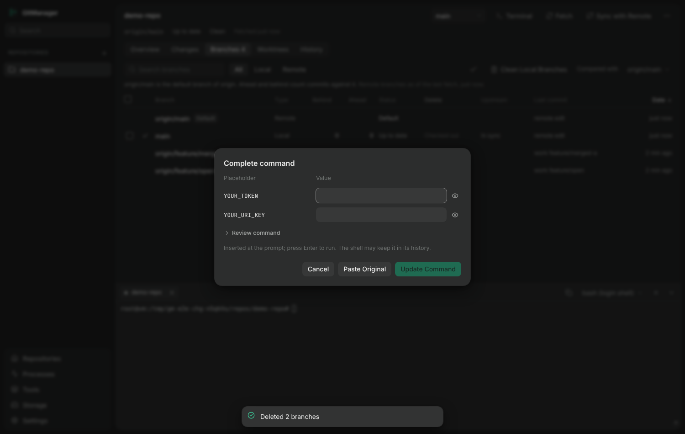

# Terminal: preferences, copy and paste, placeholders

The embedded terminal is xterm.js on a real pseudo-terminal (node-pty) in the main process; the page never gets a shell of its own.
Everything below is in `src/renderer/terminalController.ts` (behaviour), `src/shared/placeholders.ts` (detection and reconstruction) and
`src/shared/terminalPrefs.ts` (preferences). The behaviour is unit-tested without a window (`test/terminal/`) and exercised in a real
window with a real shell (`npm run test:e2e:changes`, `npm run test:e2e:terminal-select`).

## Settings > Terminal

| Setting | Values | Default |
| --- | --- | --- |
| Default shell | Automatic, PowerShell, PowerShell 7, any detected WSL distribution (Linux and macOS: the login shell) | Automatic |
| Font | Default, or an installed monospace font from a fixed list (Cascadia Code/Mono, Consolas, JetBrains Mono, Fira Code, Source Code Pro, ...) | Default |
| Font size | 8 to 32 | 13 |
| Line height | 1.0 to 2.0 | 1.0 |
| Cursor | Block, Bar, Underline, and Blinking cursor | Block, blinking |
| Scrollback lines | 100 to 100 000 | 5000 |
| Select to copy | on / off | on |
| Copy in context menu | on / off | on |
| Right-click to paste | on / off | on |

Preferences are saved in `gitmanager.json` with the other settings (a file from before v1.0.2 gets the defaults), validated in the main
process (an unsupported value is refused with the reason; the font must be one of the listed names, so a stored value can never carry
CSS), and applied to terminals that are already open as soon as they are saved. The default shell is used when a terminal opens without an
explicit shell choice and the shell can open that folder (a WSL distribution's shell cannot open a native Windows folder); otherwise the repository's
last shell, then the folder's own, as before. The header offers no per-preference buttons.

## Copy

- **Select to copy**: releasing the left mouse button after selecting copies exactly the selection (partial lines and multi-line output
  included). The selection stays highlighted and the process is not interrupted. Turning the setting off only stops the copying; text can still be selected.
- **Copy in context menu**: right-click on selected text offers Copy, which copies the text selected when the menu opened.
- Both can be on together. Ctrl+Shift+C and Ctrl+Insert copy a selection too. **Ctrl+C is never taken**: it stays the interrupt.

## Paste

- Right-click without a selection pastes (when *Right-click to paste* is on). With a selection the menu offers Copy and Paste, each when its setting is on.
- Ctrl+V, Shift+Insert and Ctrl+Shift+V paste. Anything the browser pastes by itself (the system menu, middle click) goes through the same path.
- The clipboard is read by the main process (`clipboardRead`), because the page has no clipboard permission.
- Pasted text is only inserted at the prompt through xterm's paste (bracketed when the shell asked for it). **GitManager never sends Enter**: trailing line
  breaks are removed, so a pasted command is never run by its own final newline, and control characters (including ESC) are stripped so pasted text cannot end the paste early.

## Placeholder detection

When pasted text contains an obviously unresolved placeholder, a compact dialog opens before anything is inserted. Ordinary pasting stays instant.

**Recognized** (conservative; see `detectPlaceholders`):

- names starting `YOUR_` / `YOUR-`, `INSERT_`, `ENTER_`, `PASTE_`, `REPLACE_`; names ending `_HERE`; `CHANGE_ME`; names containing `PLACEHOLDER`; `URI_KEY` as a value;
- angle forms `<TOKEN>`, `<API_KEY>`, `<your-token>`, `<api key>`; mustache `{{ name }}`; `[YOUR_X]`;
- a credential-like NAME that is a whole quoted value equal to its own variable (`$env:API_TOKEN = "API_TOKEN"`), or that a comment in the same text tells you to replace.

**Never recognized**: variables and references (`$TOKEN`, `${TOKEN}`, `$env:TOKEN`, `Env:TOKEN`, `%TOKEN%`, `@ARGS`), assignment targets (`URI_KEY=...`,
`$env:URI_KEY = ...`), parameters (`-Name`), text inside comments, `${{ secrets.X }}`, ordinary uppercase words and hyphenated text (`SHIFT-INSERT-TEXT`), and
credential-like names such as `API_TOKEN` in a literal argument (`GetEnvironmentVariable("API_TOKEN")`).

**The dialog** ("Complete command"): one input per distinct placeholder (a repeated one is asked once and replaced everywhere), secret-looking inputs masked
with a per-input reveal, a collapsed *Review command* preview (secret values shown as dots unless revealed), and three actions: **Update Command**,
**Paste Original**, **Cancel**. Update inserts the corrected command; the user presses Enter. Cancel changes nothing.

**Reconstruction** keeps everything else byte for byte and escapes each value for where it lands: PowerShell double quotes (`` ` `` before `` ` ``, `"`, `$` and the typographic double quotes),
single quotes (doubled `'` and typographic single quotes), here-strings, `$( )` sub-expressions, bare words (quoted when the value needs it); POSIX quoting for WSL shells. A value
with a line break, or one that needs quoting but sits inside a larger unquoted word (`?t=YOUR_TOKEN&a=1`), is **refused with the reason** rather than changed silently.
Values are never used to build an application-level command: the result is text for the prompt.

**Secrets.** Entered values live only in the dialog's state and are dropped when it closes: not saved in settings, not logged, not sent anywhere except into the terminal.
Limits that cannot be removed by GitManager: once the command is inserted and run, the *shell* owns it. PowerShell's PSReadLine writes history to
`%APPDATA%\Microsoft\Windows\PowerShell\PSReadLine\ConsoleHost_history.txt` (it skips some lines that look like secrets, but not reliably), bash writes `~/.bash_history`, and the
terminal's scrollback and the in-memory replay buffer (kept while the tab is open) contain what was echoed. Close the tab, and clear the history file, if that matters.

## Verified, and not

Verified in a real window on Linux (bash): right-click paste, Ctrl+V, Shift+Insert, no execution, trailing newline, the placeholder dialog end to end, Copy / Paste menu, select to copy
on and off, settings persistence and live font-size change. **Not verified here**: Windows PowerShell 5.1, PowerShell 7 and WSL terminals (no Windows host); in particular how PSReadLine treats
a multi-line paste under ConPTY. The code paths are shell-independent except the quoting rules, which are unit-tested for both PowerShell and POSIX syntax; CI runs the unit tests on Windows.
